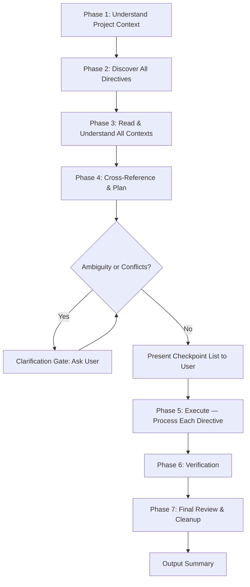
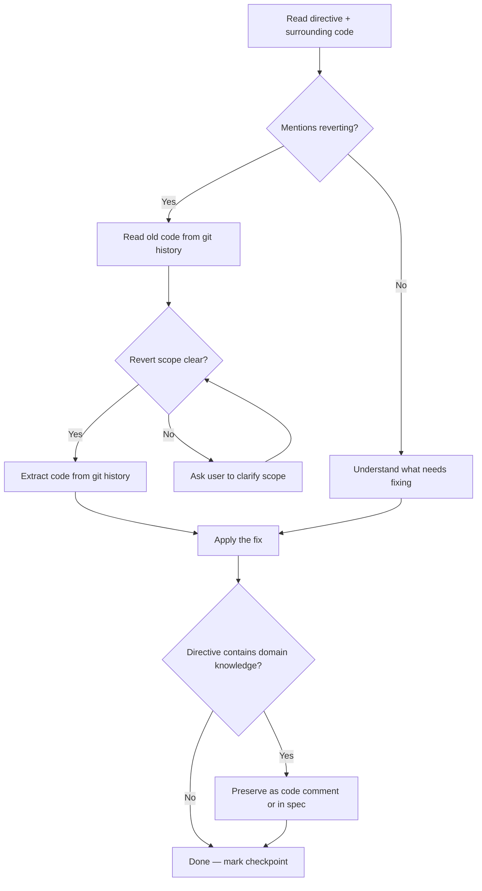
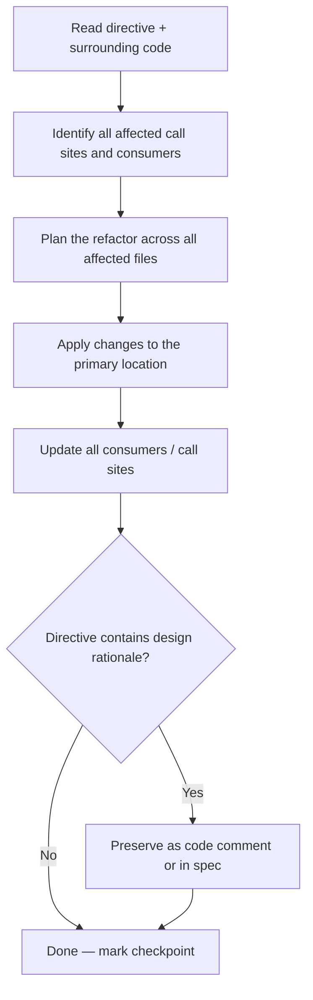
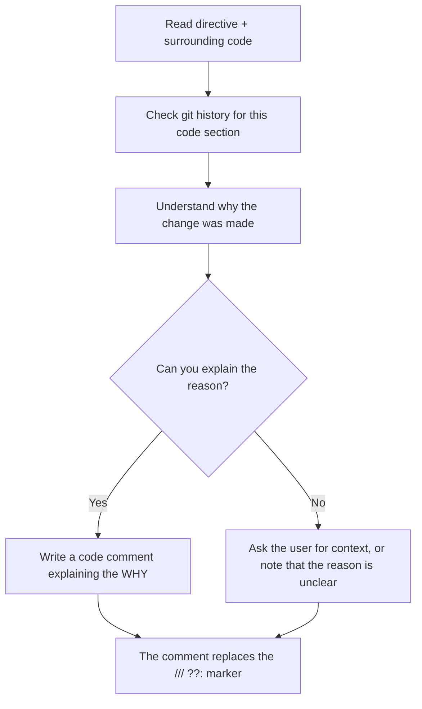

# Revision Directive Tuning

This command processes **revision directives** — inline markers that users leave in code after reviewing changes. These markers follow a fixed format and encode modification instructions, questions, or refactoring requests.


## Directive Types

| Marker | Purpose | Action |
|--------|---------|--------|
| `/// fix:` | Bug fix or correction needed | Apply the fix described in the directive |
| `/// refactor:` | Structural improvement needed | Refactor the code as described |
| `/// ??:` | User is asking "why was this changed?" | Answer by adding a clarifying comment in the code |


## Directive Format

The marker `/// fix:`, `/// refactor:`, or `/// ??:` is a **fixed literal string** that appears inside any programming language's comment syntax. It does NOT appear in Markdown, JSON, or other non-code content. Examples across languages:

```typescript
/// fix: handle null case here

/** /// fix: the return type should be Promise<void> */

/**
 * /// refactor: extract this into a shared utility
 *   this pattern is repeated in 3 other files
 */
```

```python
# /// fix: this should use dict.get() with a default
```

```bash
# /// ??: why was the timeout increased to 30s?
```

Use `rg` to locate these markers. The search locates **where directives exist** — it does not extract the full context. You must read surrounding code yourself to understand what each directive refers to.


## Context Boundary

The boundary of what a directive describes is intentionally fuzzy and varies case by case. You must judge by reading and understanding the user's intent:

- The directive text itself may span one or multiple comment lines
- The code it refers to may be the next line, the next function, or an entire module
- If you cannot determine the boundary, read the entire file
- Use your understanding of the user's intent and the code structure to decide where the directive's scope ends

`rg` only helps you find the starting points. The real context discovery happens when you read the surrounding code.


## Overall Workflow



---


## Phase 1: Understand Project Context

Before processing any directives, build an understanding of the project:

1. Read `CLAUDE.md` if it exists — understand project conventions, tech stack, commands
2. Read `AGENTS.md` if it exists — understand agent-specific guidelines
3. Check for OpenSpec specs in the project (e.g., `docs/`, `specs/`, or spec files referenced in CLAUDE.md) — understand design intent and requirements
4. This context informs how you interpret directives, what coding conventions to follow, and what verification commands are available


## Phase 2: Discover All Directives

Scan the entire project for all revision directives:

```bash
rg -n '/// (fix|refactor|\?\?):' -g '!*.md' -g '!*.json'
```

Report what you found: how many directives, in which files, of which types.


## Phase 3: Read & Understand All Contexts

For **every** directive found, read enough surrounding context to understand its full scope. This is the most critical phase — do not rush it.

- Read the entire function, method, or block the directive is attached to
- If the directive is broad or references other parts of the code, read the entire file
- If the directive mentions other files, use `fd` to locate and read them
- For `/// ??:` directives, also check `git log` and `git diff` to understand the history of the code in question

A single line of context is never sufficient. When in doubt, read more.


## Phase 4: Cross-Reference & Plan

Now that you have read all directives and their contexts, analyze them as a group:

1. **Identify relationships** — directives in different files may describe the same underlying issue or require coordinated changes
2. **Trace impact** — a single directive may require changes across multiple call sites, consumers, or test files
3. **Detect conflicts** — if two directives contradict each other, flag them
4. **Plan execution order** — based on relationships and dependencies, decide the order in which directives should be processed. Group related directives together.


### Clarification Gate

If any of the following are true, **stop and ask the user** before proceeding. List all questions as a checklist:

- [ ] A directive's description is ambiguous or unclear
- [ ] Two directives appear to contradict each other
- [ ] A directive says "revert to the old version" but the scope is unclear (whole function? one section? a test case?)
- [ ] You're unsure whether a directive's context information should be preserved as a code comment or written into a spec
- [ ] The directive references external context you can't find in the project

Do NOT proceed until every question is resolved by the user.


### Present Checkpoint List

Convert the planned execution order into a **numbered checkpoint list** and present it to the user before starting any modifications. Each checkpoint should describe:

- Which directive(s) it addresses
- Which file(s) will be modified
- What the planned change is

Example output:

```
## Tuning Checkpoint List

- [ ] 1. `src/api/client.ts:42` — fix: add null check for response.data
- [ ] 2. `src/api/client.ts:87` + `src/api/types.ts:15` — refactor: extract shared error type (related directives)
- [ ] 3. `src/utils/parse.ts:23` — ??: explain why regex was changed from /\d+/ to /\d{1,10}/
- [ ] 4. `tests/api.test.ts:156` — fix: revert test case to previous assertion

Processing...
```

Wait for the user to confirm the plan before executing.

---


## Phase 5: Execute

Process directives according to the checkpoint list. For each checkpoint:

1. **Announce** which checkpoint you are working on
2. **Keep the directive marker in place** — do not remove it yet
3. Apply the change following the type-specific behavior below
4. **Mark the checkpoint as done** and display the updated list to the user


### Behavior: `/// fix:`

Apply the fix described in the directive.



**Revert requests:** When a directive says "revert this", "use the old version", "this was better before":

1. Use `git log` to find the relevant prior commit(s)
2. Use `git show` or `git diff` to read the code **before** the change
3. Determine the revert scope — entire function, a specific section, or a single test case
4. Extract the desired code directly from the old version — copy it from git history, don't reconstruct from memory
5. If the scope is ambiguous, ask the user


### Behavior: `/// refactor:`

Refactor the code as described. Refactors often have a wider blast radius than fixes.



A refactor directive that says "extract this into a shared utility" means you need to find everywhere the pattern is duplicated, not just the one location with the marker.


### Behavior: `/// ??:`

The user is asking why the code was changed. This means the code is missing context that should have been there.



- The comment should explain the *why*, not the *what*
- Match the project's existing comment style and conventions
- Goal: if someone reads this code a year from now, the comment should prevent the same question


### Preserving Context

During execution, watch for directives that contain **context information that was previously missing from the codebase** — domain knowledge, gotchas, design decisions, pitfalls. This information must be preserved:

- **As a code comment** — if it explains local behavior or a non-obvious pitfall at this specific location
- **In the relevant spec file** — if it describes broader design intent or requirements

Also record any pitfalls you encounter during the fix itself — traps that future developers should know about.

---


## Phase 6: Verification

After all directives have been processed, run the project's verification steps. Check `CLAUDE.md`, `package.json` scripts, and project conventions for available verification commands. This typically includes:

- **Linting** — e.g., `npm run lint`
- **Type checking** — e.g., `tsc --noEmit`
- **Unit tests** — e.g., `npm test`
- **Build** — if applicable

If any verification fails, diagnose and fix the issue before proceeding. The fix should not break what was already working.


## Phase 7: Final Review & Cleanup

After all directives are processed and verification passes:

1. Re-read every directive and its surrounding code
2. For each directive, verify:
   - Does the change match what the directive asked for?
   - Is the change consistent with related directives?
   - Did any fix introduce a new problem?
3. Only after confirming a directive was properly addressed, remove the `/// fix:`, `/// refactor:`, or `/// ??:` marker
4. If any directive wasn't fully addressed, **leave the marker in place** and explain why


### Output Summary

Present a final summary to the user:

```
## Tuning Summary


### Completed
- [x] 1. `src/api/client.ts:42` — fix: added null check for response.data
- [x] 2. `src/api/client.ts:87` + `src/api/types.ts:15` — refactor: extracted SharedErrorType
- [x] 3. `src/utils/parse.ts:23` — ??: added comment explaining regex change
- [x] 4. `tests/api.test.ts:156` — fix: reverted assertion to original


### Preserved Context
- `src/api/client.ts:45` — added comment about API returning null on 204 responses
- `docs/specs/api-design.md` — added note about error type unification rationale


### Verification
- Lint: ✓
- Type check: ✓
- Tests: ✓ (24/24 passed)


### Remaining (if any)
- (none)
```

---


## Key Principles

**Read more, not less.** When you find a directive, your instinct might be to read just that line. Resist it. Read the whole function, the whole file if needed. The directive is a pointer — the real context is below and around it.

**Directives travel in packs.** A single user review session often produces multiple related directives across different files. They share context and intent. Treating them in isolation leads to inconsistent or incomplete fixes.

**Understand all before acting on any.** Read every directive and its full context before planning execution order. The relationship between directives determines how they should be sequenced and grouped.

**Preserve institutional knowledge.** Users sometimes embed important context in their review comments that doesn't exist anywhere else in the codebase. When you remove the directive marker, that knowledge disappears unless you deliberately capture it in a comment or spec.

**Git is your time machine.** For revert requests, always go to the source — read the actual old code from git history. Don't guess what the old version looked like.


## Tool Requirements

This skill requires `rg` (ripgrep) and `fd` (fd-find) as CLI dependencies. If either is missing, install them:

```bash
# macOS
brew install ripgrep fd

# Ubuntu/Debian
apt install ripgrep fd-find
```
